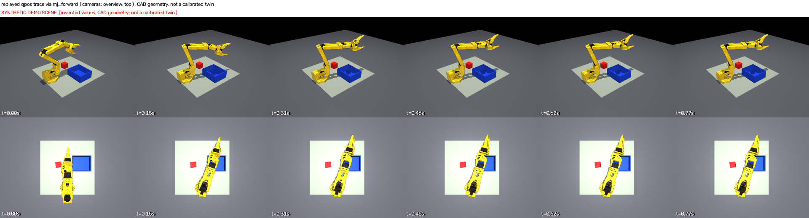
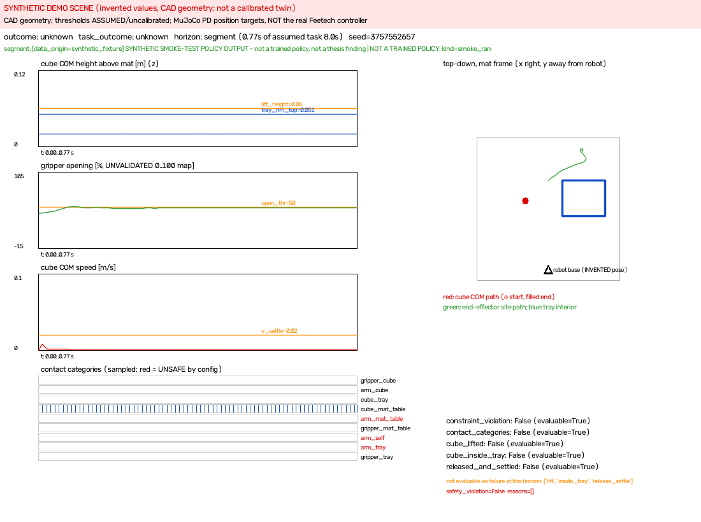
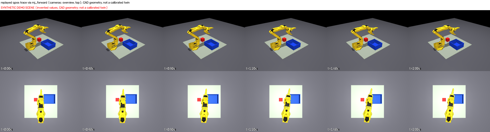
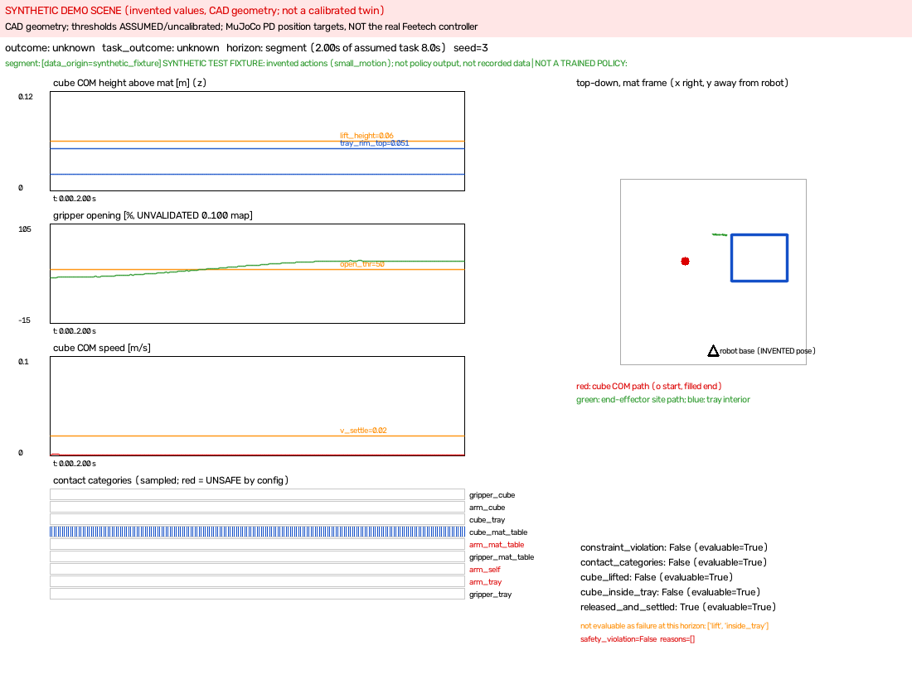

# Sim-Before-Act for SO-101

**Project website and documents** · [Sim-Before-Act](https://fyp-sim-before-act-public.vercel.app/#documents)

[Quick start](#run-the-offline-demo) · [Reference results](#reference-results) · [Scene replay](#synthetic-scene-replay) · [Output files](#output-files)

An M.Tech research prototype for collecting SO-101 teleoperation demonstrations and evaluating proposed robot actions offline with MuJoCo. The collector stores RGB-D frames, joint telemetry, commands, and calibration metadata in a lossless master episode. Sim-Before-Act runs proposed action segments under sampled conditions, checks outcomes, and records whether the offline gate would accept or reject the segment.

The workflow has been exercised with synthetic and mock data. Physical validation is pending, and the follower-to-simulator calibration mismatch remains open. The ACT integration uses a randomly initialized policy for a smoke test. Training and evaluating a task policy remain future work. [Calibration audit](sim_before_act/docs/CALIBRATION_AUDIT.md) · [Simulation status](sim_before_act/docs/STATUS.md) · [Collector status](robot_collector/docs/STATUS.md)

## How the pipeline works

1. **Collect and export.** The collector writes a lossless master episode with RGB, native and aligned depth, joint telemetry, commands, and calibration metadata. It derives RGB/joint-angle and RGB-D/motor-position exports from the same episode.
2. **Validate the action segment.** Sim-Before-Act checks the segment's joint order, units, limits, provenance, and hash. The demo supplies an invented action or a segment from the ACT smoke integration.
3. **Simulate under uncertainty.** MuJoCo reruns the same action segment under seeded changes to initial joint state, object pose, friction, and control noise. It records constraint violations and cube-to-tray task predicates for lift, placement, and release/settle.
4. **Gate on observed evidence.** The verifier checks which safety and task outcomes are evaluable. It can withhold the simulated failure fraction when the rollout ends before a task outcome can be determined.
5. **Save the results.** The demo writes structured verification outputs, rollout plots, a shadow prediction annotated `not_executed`, and a review report with a dataset card.

The demo runs without a camera, serial connection, or physical robot session. [Action contract](sim_before_act/docs/ACTION_CONTRACT.md) · [Scene and outcome predicates](sim_before_act/docs/SCENE.md) · [Shadow records and reporting](sim_before_act/docs/SHADOW_AND_REPORTS.md)

## Run the offline demo

From the repository root, use Python 3.12 in an activated virtual environment. Both packages are needed because the demo runs the collector on mock inputs before passing a synthetic action segment to MuJoCo.

```bash
python -m pip install -e ./robot_collector -e "./sim_before_act[lerobot-import]" pytest
python -m sim_before_act.demo --out sim_before_act/outputs/local_demo --no-act-smoke --no-render
```

Use a fresh output path for each run. `--no-act-smoke` lets the demo run without a separate LeRobot environment. `--no-render` skips the contact sheet and still produces plots. Start with `DEMO_REPORT.md` in the output directory. [Reference demo report](sim_before_act/outputs/offline_demo_gate_fix_v1/DEMO_REPORT.md) · [Synthetic rollout assets](sim_before_act/assets/README.md)

The offline gate treats missing outcome evidence as `INSUFFICIENT_EVIDENCE` and returns `WOULD_REJECT`. Synthetic results exercise the pipeline and gate. Real-world predictive validity remains untested.

## Reference results

### ACT smoke integration

The checked-in run generated four synthetic episodes and exercised collector validation, inventory, replay, both export profiles, ACT segment generation, verification, shadow logging, and reporting. The ACT smoke model started from random weights and took a few CPU steps. Its `trained_for_task` flag is `false`.

| Measurement | Result |
| --- | --- |
| Rollout count and base seed | 10 rollouts, seed 0 |
| Safety outcomes evaluable | 10/10, with zero observed violations |
| Task outcomes evaluable | 0/10. All ten remained unknown at the segment horizon. |
| Evidence covering both safety and task | 0/10 determined. The configuration required at least 8/10. |
| Gate result | `INSUFFICIENT_EVIDENCE` → `WOULD_REJECT`, approval scope `none` |
| Simulated failure fraction and interval | Both withheld |

The demo's 0.3 failure threshold and 0.8 evidence coverage requirement are uncalibrated. The offline labels describe what the gate would decide. Physical validation and task-performance evaluation remain pending. [Reference report](sim_before_act/outputs/offline_demo_gate_fix_v1/DEMO_REPORT.md)





### Deterministic fixture checks

All five synthetic cases matched their expected gate results using ten rollouts each.

| Case | Observed outcomes | Verification status | Decision and scope | Simulated failure fraction |
| --- | --- | --- | --- | --- |
| B1. Hold pose, safety-only scope | 10 clean safety observations. Task outcomes unknown. | `COMPLETED` | `WOULD_EXECUTE`, safety only | 0.0 |
| B2. Hold pose through the assumed task horizon | 10 task failures | `COMPLETED` | `REJECT`, none | 1.0 |
| B3. Known constraint violation | 10 safety violations | `COMPLETED` | `REJECT`, none | 1.0 |
| B4. Insufficient task evidence | 10 unknown task outcomes | `INSUFFICIENT_EVIDENCE` | `REJECT`, none | Withheld |
| B5. Start state outside simulator limits | 10 invalid rollouts | `INSUFFICIENT_VALID_ROLLOUTS` | `REJECT`, none | Withheld |

### Rollout-budget comparison

The comparison uses nested seeds at 1, 5, and 10 rollouts with the full safety and task scope.

| Case | N = 1 | N = 5 | N = 10 | Gate result across all budgets |
| --- | --- | --- | --- | --- |
| Safe fixture | 1 unknown | 5 unknown | 10 unknown | `INSUFFICIENT_EVIDENCE` → `REJECT`, fraction withheld |
| Invented unsafe fixture | 1 safety violation | 5 safety violations | 10 safety violations | `COMPLETED` → `REJECT`, fraction 1.0 |
| ACT smoke segment | 1 unknown | 5 unknown | 10 unknown | `INSUFFICIENT_EVIDENCE` → `REJECT`, fraction withheld |

### Synthetic scene replay

The separate `small_motion` scene example uses perturbation seed 3 and 45 joint-position targets. The rollout lasts 2.0 seconds including settling, with an assumed task horizon of 8.0 seconds. It recorded no configured safety violation. The task outcome was `unknown`. [Replay video (MP4)](sim_before_act/assets/scene_demo/rollout_fixture_small_motion_seed3_replay.mp4) · [Scene summary](sim_before_act/assets/scene_demo/rollout_fixture_small_motion_seed3_summary.json)





## Output files

### Included in GitHub

| Files | Contents |
| --- | --- |
| [Demo report](sim_before_act/outputs/offline_demo_gate_fix_v1/DEMO_REPORT.md) · [Demo summary JSON](sim_before_act/outputs/offline_demo_gate_fix_v1/demo_summary.json) | End-to-end run, fixture results, budget comparison, and step status. |
| [Verification JSON](sim_before_act/outputs/offline_demo_gate_fix_v1/04_verification/verification.json) · [Outcome audit JSON](sim_before_act/outputs/offline_demo_gate_fix_v1/04_verification/outcome_audit.json) | Gate reasons, evidence counts, and per-rollout outcome details. |
| [ACT contact sheet](sim_before_act/outputs/offline_demo_gate_fix_v1/04_verification/rollout0_contact_sheet.png) · [ACT diagnostic plot](sim_before_act/outputs/offline_demo_gate_fix_v1/04_verification/rollout0_plot.png) | Frames and diagnostics for the first smoke-integration rollout. |
| [Scene fixture JSON](sim_before_act/assets/scene_demo/fixture_small_motion.json) · [Scene summary JSON](sim_before_act/assets/scene_demo/rollout_fixture_small_motion_seed3_summary.json) · [Trace NPZ](sim_before_act/assets/scene_demo/rollout_fixture_small_motion_seed3_trace.npz) | Input action segment, outcome and perturbation metadata, and sampled rollout arrays. |
| [Scene contact sheet](sim_before_act/assets/scene_demo/rollout_fixture_small_motion_seed3_contact_sheet.png) · [Scene diagnostic plot](sim_before_act/assets/scene_demo/rollout_fixture_small_motion_seed3_plot.png) · [Scene replay MP4](sim_before_act/assets/scene_demo/rollout_fixture_small_motion_seed3_replay.mp4) | Visual outputs for the seed-3 scene rollout. |
| [Collector preflight records](robot_collector/data/preflight/) · [Camera calibration records](robot_collector/data/calibrations/) · [Follower calibration records](robot_collector/data/robot_calibration/) | Recorded setup and calibration evidence. |

### Generated by a fresh demo run

| Path under the demo output directory | Contents |
| --- | --- |
| `DEMO_REPORT.md`, `demo_summary.json` | Human-readable report and structured summary. |
| `01_fixture_episodes/` | Synthetic episodes, manifest, and split. |
| `03_fixture_segment/` or `03_act_smoke/` | Action segment supplied to the verifier. |
| `04_verification/` | Verification JSON, outcome audit, rollout traces, and plot. Rendering support also enables a contact sheet. |
| `05_budget_cases/`, `05_budget_rows.json` | Runs and structured results for the three rollout budgets. |
| `05b_synthetic_verification_fixtures/` | The five deterministic cases and the comparison of expected and observed results. |
| `06_shadow/` | Shadow prediction and `not_executed` annotation. |
| `07_report/` | Review report, dataset card, and structured report outputs. |
| `logs/` | Fixture and collector command logs, plus the ACT smoke log when enabled. |

## Repository layout

| Directory | Contents |
| --- | --- |
| [`robot_collector/`](robot_collector/) | RGB-D and telemetry collection, episode validation, export profiles, and ACT conversion. |
| [`sim_before_act/`](sim_before_act/) | MuJoCo rollouts, action contracts, evidence gating, and synthetic demos. |
| [`lerobot_setup/`](lerobot_setup/) | Lab-specific Linux teleoperation wrapper and calibration files. |
| [`so101_mujoco/`](so101_mujoco/) | SO-101 MJCF model and meshes used by the simulator. |

Keep these directories side by side so the configuration files can resolve model and calibration paths. Raw recordings and training checkpoints are stored outside the repository. Hardware profiles in this checkout contain lab-specific device identifiers and paths.

## Run the tests

```bash
python -m pytest -q robot_collector
python -m pytest -q sim_before_act
```

Run the suites separately. ACT integration tests that require the separate LeRobot environment may skip when it is unavailable. [Environment and test details](robot_collector/docs/HANDOFF.md)

## Project documentation

- Collector setup and data formats. [Collector README](robot_collector/README.md) · [Episode schema](robot_collector/docs/SCHEMA.md) · [ACT conversion](robot_collector/docs/ACT_CONVERSION.md)
- Simulator inputs and evaluation. [Simulator README](sim_before_act/README.md) · [Schemas](sim_before_act/docs/SCHEMAS.md) · [Data readiness](sim_before_act/docs/DATA_READINESS.md)
- Open items for physical validation include joint-zero and limit alignment, measuring the base-to-mat transform and cube/tray geometry, and collecting labelled physical trials. [Calibration audit](sim_before_act/docs/CALIBRATION_AUDIT.md) · [Simulation status](sim_before_act/docs/STATUS.md)

## Model attribution

The bundled SO-101 model is based on TheRobotStudio’s SO-ARM100 project. This checkout contains the MJCF model and a subset of the upstream assets. The upstream Apache 2.0 license applies to the upstream material. The project code has no repo-wide license. [Upstream SO-101 model](https://github.com/TheRobotStudio/SO-ARM100/tree/main/Simulation/SO101) · [Bundled license](so101_mujoco/LICENSE)
